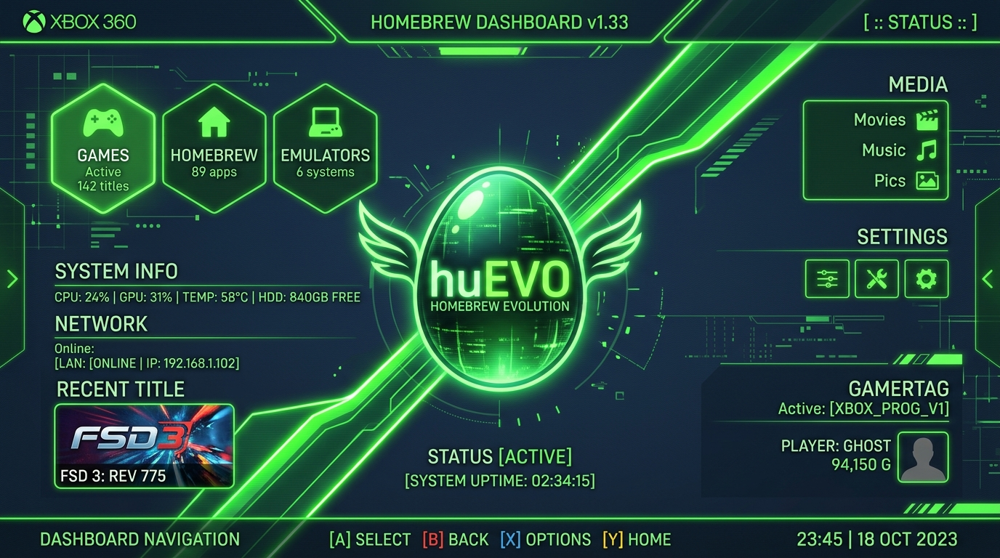

# 🎮 huEVO for Xbox 360 (Homebrew Edition by SWAGDEV)

> **Нативный клиент независимой ретро-соцсети [huEVO](https://huevo.su) для Microsoft Xbox 360 (Freeboot / RGH / JTAG / Devkit)**  
> **Интерфейс в аутентичном стиле VKontakte circa 2016 (тёмная тема, полноразмерные карточки, чаты, стена и звучок)**



---

## 🌟 Возможности приложения

* **Нативный Direct3D 9 рендерер (720p 16:9)**:
  * Аппаратный рендеринг без веб-врапперов или браузерных заглушек.
  * Точная палитра `huevo.su`: `#141517` (фон), `#1F2022` (шапка), `#1C1D1F` (карточки), `#5181B8` (ссылки).
  * Кастомный знакогенератор с поддержкой **полного русского алфавита (кириллица А–Я, а–я, Ё, ё)**, латиницы ASCII, глифов кнопок геймпада и верификации.
* **Полноценный мессенджер**:
  * Список диалогов и бесед с аватарами, количеством участников, превью последних реплик, датами и бейджами непрочитанных сообщений (`99+`).
  * Полноэкранный режим чата с раздельными карточками входящих (`#27282D`) и исходящих (`#2B3A4C`) сообщений.
  * Отправка сообщений и публикация постов прямо с геймпада.
* **Нативная системная клавиатура (`XShowKeyboardUI`)**:
  * Вызов виртуальной экранной клавиатуры дашборда Xbox 360 с поддержкой русского языка, аппаратных клавиатур, Chatpad и джойстика.
* **10 реализованных разделов по скриншотам сайта**:
  1. **Моя Страница**: аватар, статус «чуитс детка», онлайн-метка, город `SWAGINO`, день рождения, репутация `14`, плашка статистики (88 друзей, 21 группа, 85 аудио), витрина подарков (`#79/100`), форма публикации и стена.
  2. **Новости**: официальное объявление (`t.me/huEVOsocial`), вкладки («Рекомендации», «Все записи», «Друзья»), лента постов со счетчиками лайков и комментариев.
  3. **Сообщения**: поиск по беседам, диалоги («хуева.чАТ», «Император», «влад сораши», «САПОГ»), чат и отправка сообщений.
  4. **Друзья**: подкатегории («Все друзья», «Онлайн», «Заявки», «Подписки»), карточки пользователей и кнопка быстрого перехода к диалогу.
  5. **Уведомления**: журнал действий (лайки, новые записи, принятые заявки в друзья).
  6. **Сообщества**: список групп («VETMO 18+», «семьсот семь», «huEVO SWAGdev»).
  7. **Звучок**: ретро аудиоплеер с анимированным визуализатором-эквалайзером в стиле Xbox 360 Blades Dashboard и плейлистом треков.
  8. **Видеозаписи**: каталог роликов с хронометражем и просмотрами.
  9. **Маркет и Игры**: баланс монэток (`301 680 м.`), биржа юзернеймов (`@19cm`, `@18cm`, `@mp3music`), кликер «Копилка» (нажатие `(A)` приносит монэтки) и рулетка.
  10. **Настройки**: конфигурация IP моста, управление звуками и сессией.
* **Интеграция с Aurora Dashboard**:
  * Готовый исполняемый файл `default.xex` (XEX2 base `0x82000000`).
  * Официальный баннер `banner.png` и иконка `icon.png`.
  * Корректный возврат в дашборд по кнопке `Back`.

---

## 🕹 Управление геймпадом Xbox 360

| Кнопка | Назначение |
| :--- | :--- |
| **D-Pad / Левый Стик** | Навигация по пунктам меню и карточкам контента |
| **(A)** | Выбрать / Открыть диалог / Поставить лайк / Включить трек / Клик в Копилке |
| **(B)** | Назад (выход из чата к списку диалогов или возврат в сайдбар) |
| **(X)** | Написать (вызов нативной экранной клавиатуры для поста или сообщения) |
| **(Y)** | Обновить ленту / диалоги |
| **(LB) / (RB)** | Быстрое переключение между вкладками |
| **Back** | Безопасный возврат в дашборд консоли |

---

## 🚀 Установка на Xbox 360 (Aurora / Freestyle Dashboard)

### 1. Скопируйте файлы на консоль
Поместите папку приложения на внутренний жесткий диск консоли через FTP или USB-накопитель (FAT32):
```text
Hdd1:\Homebrew\huEVO\
├── default.xex         # Исполняемый файл Xbox 360 (скомпилирован тулчейном OXDK)
└── assets\
    ├── icon.png        # Квадратная иконка для интерфейса дашборда
    └── banner.png      # Широкоформатный баннер для Aurora
```

### 2. Запуск
1. В меню **Aurora Dashboard** обновите пути сканирования (`Scan Paths`).
2. Плитка **huEVO** отобразится в категории **Homebrew** с оригинальной иконкой и баннером.
3. Запустите приложение.

---

## 🌐 Сетевой компаньон-мост (Companion Bridge)

Так как сервер `huevo.su` использует современный TLS/HTTPS на порту 443 и динамическую анти-бот защиту (`data-hchk-a` / `data-hchk-b`), в комплекте идёт автономный скрипт моста на стандартной библиотеке Python 3 (работает на Mac, Windows и Linux без установки сторонних пакетов).

### Запуск моста на компьютере в той же Wi-Fi сети:
```bash
python3 bridge/bridge.py
```
Мост автоматически определит ваш локальный IP (например, `192.168.31.219:8080`) и начнет проксировать запросы с консоли, автоматически решая капчу и сохраняя сессионные куки.

Приложение также содержит **полный автономный офлайн-режим**, поэтому все вкладки, диалоги и посты работают и доступны для просмотра даже без подключенного моста.

---

## 🛠 Сборка проекта (OXDK на macOS / Linux)

Для сборки используется установленный тулчейн **OXDK** с модифицированным компилятором Clang (поддержка `xenon-abi`):

```bash
make clean
make
```
В результате создается готовый файл `default.xex` (размер ~3.3 МБ, 225 импортов из `xam.xex` и `xboxkrnl.exe`).
